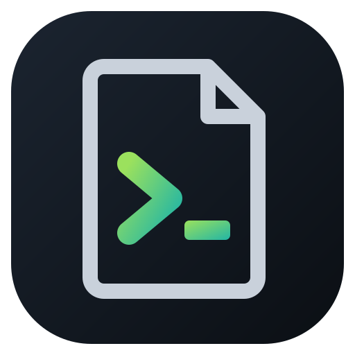
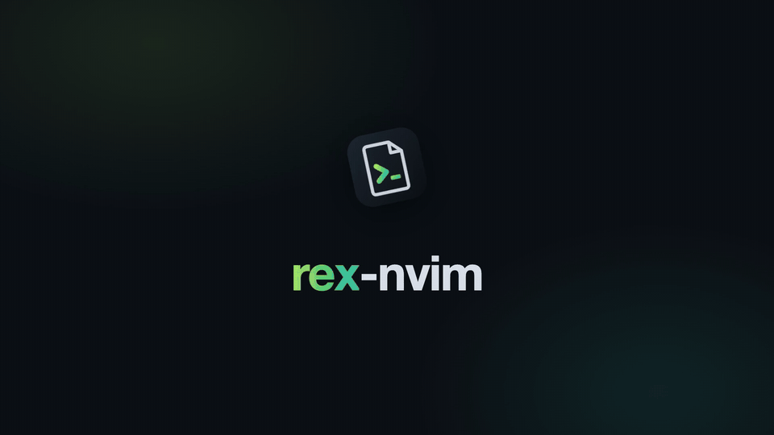

<p align="center">
  
</p>

<h1 align="center">rex-nvim</h1>

nvim integration for the [Rex](https://www.superlogical.com/rex) terminal on macOS: clicking a file hyperlink (or double-clicking a code file in Finder) opens it in nvim inside Rex instead of a GUI editor.

<p align="center">
  
  <br>
  <sub><a href="docs/assets/teaser.mp4">Full-resolution video (MP4)</a></sub>
</p>

Where a file goes, first match wins:

1. The nvim running in a Rex pane whose working directory holds the file: it loads there and Rex focuses its pane.
2. The Rex session that has a terminal sitting in the file's project (the deepest terminal working directory above the file): a new nvim tab opens there, in that directory, so it takes the next files of that project too.
3. The Rex session `files`, created on first use: the nvim already running there receives the file, else a new nvim tab opens.

Markdown no nvim already holds opens read-only in [glow](https://github.com/charmbracelet/glow) instead (`q` closes it). Rex.app is launched if needed and switched to the session the file landed in.

## Install

```sh
brew install neovim duti jq glow
git clone https://github.com/AlbertoBarrago/rex-nvim.git ~/Projects/rex-nvim
~/Projects/rex-nvim/install.sh     # links rex-nvim into ~/.local/bin
rex-nvim install                   # asks the scope, then which file types go to nvim
rex-nvim doctor                    # after confirming the dialogs
```

In Rex, turn on **Remote Control** (Settings, Rex Server). Without it Rex refuses the `session.select` that brings the file's session into view: the file opens, but in a session you are not looking at, so a double-click seems to do nothing. `rex-nvim install` and `rex-nvim doctor` both check it.

### Global, or only inside Rex

`rex-nvim install` first asks where files should open in nvim:

- **global** (the default): NvimOpen becomes the default app for code files, so Finder double-clicks and `file://` links clicked anywhere, Rex included, open in nvim. macOS asks to confirm each file type once.
- **rex**: no file type is bound and no macOS dialog appears. Finder keeps opening files in your IDE. In Rex, `rex-nvim://` links (see "Links that jump to the line": ripgrep, delta) and `rex-nvim open` reach nvim; plain `file://` links clicked in Rex still go to the default app, because Rex hands them to macOS.

The choice is saved in `~/.config/rex-nvim/scope` and kept by later runs (and by `--yes`); `rex-nvim install --scope global` or `--scope rex` sets it without asking. Switching from global to rex does not take file types back from NvimOpen: the previous app is unknown and each change would bring a dialog again. The install and `rex-nvim doctor` list them; give one back from Finder (Get Info, Open with, Change All). In the rex scope `rex-nvim install EXT...` refuses to bind.

### Choosing file types (global)

`rex-nvim install` lists every file type that does not open in nvim yet, with the app opening it today and a suggestion: nvim, or keep the current app when that app owns the type (Xcode for `.swift`, `.m`, `.mm`; Android Studio or IntelliJ IDEA for `.kt`, `.kts`, `.gradle`). In the picker, move with the arrows or `j`/`k`, toggle a type between nvim and keep with space, set every type to nvim with `a`, go back to the suggestions with `s`, apply with Enter, or stop without changes with `q` or Esc. On a terminal without cursor support (`TERM=dumb`) it asks line by line instead: Enter accepts the suggestions, `p` picks each type, `q` stops. Colors follow [`NO_COLOR`](https://no-color.org), and so does `rex-nvim doctor`. `rex-nvim install --yes`, or a run without a terminal, takes the suggestions without asking.

macOS asks to confirm each newly bound file type (one per type that already has another default app: up to about 30 on a fresh machine, none on a rerun): confirm only the ones that name NvimOpen. `rex-nvim install EXT...` binds only the given extensions, handy to add one later.

The types left on their app are listed in `~/.config/rex-nvim/keep`, one extension per line, which can also be edited by hand. `rex-nvim install` skips them and `rex-nvim doctor` reports them as kept instead of failing. macOS binds content types, not extensions, so extensions sharing one (`yaml` and `yml`, `js` and `mjs`, `ts` and `tsx`) are kept together or not at all. `rex-nvim install EXT...` takes an extension, and its group, back off the list.

Then load the nvim plugin, so every nvim started in a Rex pane registers itself. `rex-nvim install` offers to do it when the config does not load it yet: with lazy.nvim importing `lua/plugins` it writes the spec below there, without a plugin manager it links the plugin into nvim's `pack` directory. It never overwrites an existing file, and `--yes` only prints what it would do. By hand, with lazy.nvim, add a spec (for example `lua/plugins/rex-nvim.lua`):

```lua
local dir = vim.fn.expand("~/Projects/rex-nvim/nvim")
return {
  { dir = dir, name = "rex-nvim", lazy = false, cond = vim.uv.fs_stat(dir) ~= nil },
}
```

Without a plugin manager, `vim.opt.rtp:append(vim.fn.expand("~/Projects/rex-nvim/nvim"))` in `init.lua` does the same. `rex-nvim edit` loads the plugin even when the config does not.

`glow` is optional: without it Markdown opens in nvim too.

### Links that jump to the line

macOS hands a clicked `file://` link to the app without any line number. NvimOpen also handles its own scheme, `rex-nvim://open/<absolute path>?line=N&column=M`, which tools that emit OSC 8 hyperlinks can be told to use:

```sh
# ripgrep, e.g. in the file named by $RIPGREP_CONFIG_PATH
--hyperlink-format=rex-nvim://open{path}?line={line}&column={column}
```

```ini
# delta, in ~/.gitconfig
[delta]
	hyperlinks = true
	hyperlinks-file-link-format = "rex-nvim://open{path}?line={line}"
```

Rex may ask before opening a link with a custom scheme (Settings, Terminal, Links). Any app or web page can open a `rex-nvim://` link too: all it can do is open a local path in nvim (or glow), never run anything, and the path is passed as an argument, not through a shell.

## Commands

| Command | What it does |
| --- | --- |
| `rex-nvim open FILE[:LINE[:COL]]\|URL...` | Open files (or `rex-nvim://` links) as described above. This is what NvimOpen.app runs. |
| `rex-nvim edit [DIR]` | Start nvim in `DIR` (default `.`) with the plugin loaded. |
| `rex-nvim install [--yes] [--scope global\|rex]` | Build `~/Applications/NvimOpen.app`, ask the scope and, for global, which supported file types (listed in `lib/types.zsh`) go to nvim, bind them, and offer to load the plugin from the nvim config. |
| `rex-nvim install EXT...` | Bind only these extensions to nvim, taking them off the keep list (global scope only). |
| `rex-nvim doctor` | Check tools, that the app points to this clone, which app really opens each file type (kept types included; in the rex scope, the types still left on NvimOpen), that web links and `.html` still go to the browser, the Rex app and its Remote Control setting, that the nvim config loads the plugin, and the nvim open right now. |

Errors are shown as macOS notifications and logged to `~/Library/Logs/rex-nvim.log`. If the clone moves, clicks report it until `rex-nvim install` is run again from the new place.

## How it works

```
click on a file link
  -> macOS LaunchServices -> NvimOpen.app (default app for the file type)
  -> rex-nvim open FILE
       1. registered nvim whose cwd holds FILE -> rex focus its pane, open FILE through the plugin (3 s timeout)
       2. session with a terminal in FILE's project -> new nvim tab there
       3. session "files" -> its nvim, else a new nvim tab
     then Rex.app shows that session (session.select)
```

- **Registry.** The plugin (`nvim/`) runs in every nvim with `$REX_BLOCK` set, that is inside a Rex pane. It writes `~/.cache/rex-nvim/<pid>.reg` with the physical working directory, the Rex session and block, and nvim's RPC address; it refreshes it on `:cd` and when the pane gains focus, and removes it on exit. `open` drops registrations whose process is gone. The deepest matching directory wins; among nvim on the same one, the most recently focused.
- **Opening.** `open` calls the plugin's `open()` over RPC rather than `--remote`: it picks a regular window (never a `winfixbuf` sidebar, a floating or special window), leaves insert mode, does not stop on an existing swap file, and moves the cursor to `LINE:COL`. A busy nvim (for example running `:!npm test`) answers only when done, so after 3 seconds the file goes to the next target instead.
- **Choosing a session.** The Rex server does not know which session the app is showing, and `rex run` refuses to guess when several exist. So the target comes from the file itself: each terminal reports its working directory, and the deepest one above the file wins (shells sitting in `$HOME` or above are ignored). The `files` session catches the rest. The app is then asked to show that session (`session.select`).
- **File types.** NvimOpen binds exact content types (UTIs), never generic ones such as `public.data`: declaring those makes macOS offer the app for every file. `html` is left out on purpose, since binding `public.html` makes the app the default web browser. `.plist` stays with Xcode (macOS types binary plists the same way). macOS types `.ts` as MPEG-2 video first, so that video type is bound too and `.ts` videos open in nvim. Extensions macOS has no type for (`.jsx`, `.lua`, `.rs`, `.go`, `.kt`) get a type declared by NvimOpen.

## Known limits

- Clicked `file://` links open the file, not the line (see "Links that jump to the line"). Plain `path:line` text that a program prints without a hyperlink is not clickable as a link at all.
- An nvim without the plugin loaded does not receive files.

## Tests

```sh
zsh test/run.zsh
```

The suite starts real headless nvim instances with the plugin loaded; `rex` and `glow` are stubs that come first in `PATH`, so it never touches your Rex sessions or LaunchServices.

## License

MIT
